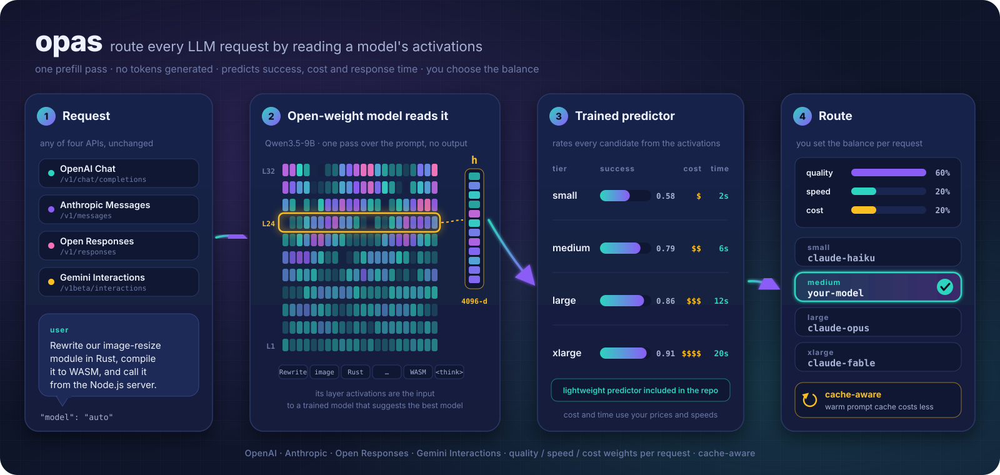

# opas

<p align="center">
  
</p>

A model router for LLM requests: for each request, opas picks the model that best fits
the quality, speed and cost balance you set. Clients send requests in the API they
already use; opas chooses a model and proxies the request to that model's provider. It
can also return only the decision, or be used as a library.

- **Four APIs, unchanged on the wire:** OpenAI Chat Completions, Anthropic Messages,
  Open Responses (OpenAI Responses API) and Gemini Interactions. Responses stream through
  as-is, and errors come back in each API's own format.
- **Generic tiers:** you describe your models as `small`, `medium`, `large` or `xlarge`
  (Fable-class), with prices and speeds. The router reasons about tiers, not model names.
- **You choose the balance:** for every candidate opas predicts the chance of success,
  the cost and the response time. Clients weight quality, speed and cost per request
  (default 60 / 20 / 20) and get all estimates back from `/v1/route`.
- **Prices from models.dev, overridable:** model prices come from the open
  [models.dev](https://models.dev) catalog by default. The operator can set prices in the
  config, and the consumer can override them per request.
- **Routing on model activations:** the probe router runs a local open-weights model
  (Qwen3.5-9B) over the request, without generating anything. A trained linear probe
  turns its hidden states into each tier's chance of success and expected output tokens.
- **Cache-aware:** opas knows which model served each conversation. Switching models
  mid-conversation loses that provider's prompt cache, so a switch has to be worth it.
- **Provider-state affinity:** follow-ups that reference stored provider state
  (`previous_response_id`, `previous_interaction_id`) always go back to the model that
  holds it.

Background research: [llm-routers.md](llm-routers.md) (a survey of routers, APIs and
benchmarks) and [docs/complexity-from-activations.md](docs/complexity-from-activations.md)
(the activation-probe design and measurements).

## How routing works

For each request:

1. **Parse.** The request is parsed into one format-independent view: system prompt,
   messages (including tool calls and results), tools, and stream flag.
2. **Check stored state.** If it continues provider-stored state (`previous_response_id` /
   `previous_interaction_id`) that opas saw being created, it goes to the same model.
   *Router: `affinity`.*
3. **Look up the conversation.** Otherwise the message history is fingerprinted prefix by
   prefix. If an earlier turn of this conversation was served within the cache TTL, the
   router is told which model served it and roughly how many prompt tokens that
   provider has cached.
4. **Route.** The probe router picks a candidate (without a `[router]` in the config,
   opas is a plain proxy and requests must name a model):
   - The encoder (Qwen3.5-9B, in-process via llama.cpp) runs one prefill pass over the
     chat-formatted request, and the hidden state of one layer is taken.
   - For each candidate's tier, linear heads predict the success probability `p̂` and
     output tokens.
   - Cost = prompt tokens × input price + predicted output tokens × output price.
     Prices come from the request, the config, models.dev or the tier's defaults (most
     specific first). For the model that served the
     previous turn, the cached part of the prompt is billed at the cached-input price.
   - Response time = time to first token + output tokens ÷ output speed (the
     candidate's `speed` or its tier's defaults): the total time to the complete
     response.
   - Each candidate gets three 0–1 scores:
     - **quality** = `p̂` relative to the best candidate's `p̂` (1 for the most likely
       to succeed);
     - **cost**: 1 for the cheapest, falling to 0 at 100× the cheapest (log scale);
     - **speed**: 1 for the fastest, falling to 0 at 10× slower.
   - They are combined with the request's **weights**. The default is quality 60 /
     speed 20 / cost 20, as in OpenRouter's Router Index; set them per request with
     `x-opas-weights: quality=…,speed=…,cost=…`, a preset (`x-opas-preference: quality`,
     `balanced`, `cost` or `speed`), or `weights` / `preference` in `/v1/route`.
   - The highest weighted score wins. Every candidate's estimates (success
     probability, expected cost, expected response time and the scores) are returned
     by `/v1/route`, so a client can also apply its own rule.
5. **Forward.** The request goes to the chosen model's upstream for that API format,
   with the model name rewritten. The response streams back. For stateful APIs, the
   response id is recorded for step 2.

Default tier prices (USD per million tokens) are used when a model has no `pricing`:

| Tier | Input | Cached input | Output |
|---|---|---|---|
| small | 0.10 | 0.01 | 0.50 |
| medium | 2.00 | 0.10 | 10.00 |
| large | 4.00 | 0.20 | 20.00 |
| xlarge | 8.00 | 0.20 | 40.00 |

and default speeds when it has no `speed` (output tokens per second including thinking;
time to first token), set from Anthropic's models measured in November 2026:

| Tier | Output speed | Time to first token |
|---|---|---|
| small | 180 tokens/s | 0.8 s |
| medium | 120 tokens/s | 1.2 s |
| large | 90 tokens/s | 1.4 s |
| xlarge | 80 tokens/s | 1.5 s |

**These speeds are estimates.** They are rough figures from a handful of requests, and
real speed varies with provider, load, effort level, Fast mode and prompt length. They
only feed the response-time estimate (and so the speed weight), but the closer they are
to your traffic, the better the trade-off. Operators should set measured values per
model in the config:

```toml
[[models]]
id = "claude-opus-5-5"
tier = "large"
speed = { output_tokens_per_sec = 110, ttft_s = 1.3 }   # what you observe
```

`GET /v1/decisions/{id}` and the `completed` log line report each response's actual
time to first byte, total time and output tokens per second, which is a good source
for these values. Prices work the same way: set `pricing` per model to override
models.dev and the tier defaults.

## Quick start

```sh
curl -fsSL https://raw.githubusercontent.com/panuhorsmalahti/opas/main/scripts/install.sh | sh
export ANTHROPIC_API_KEY=...
opas
```

The installer (macOS on Apple Silicon or Intel, Linux x86_64 / arm64; on Windows use
`irm https://raw.githubusercontent.com/panuhorsmalahti/opas/main/scripts/install.ps1 | iex`
in PowerShell):

- puts `opas` and `opas-encode` in `~/.local/bin`, from the latest
  [release](https://github.com/panuhorsmalahti/opas/releases), after checking the checksum;
- puts the trained predictor in `~/.local/share/opas/probes/`;
- downloads the encoder model (Qwen3.5-9B Q8_0, 9.5 GB) to `~/.local/share/opas/models/`,
  resuming if interrupted;
- writes `~/.config/opas/opas.toml` (routing between Claude Opus and Haiku) unless one
  exists.

`opas` reads `./opas.toml` if present, otherwise `~/.config/opas/opas.toml`. The script's
header lists its options (version, directories, skipping the model).

### Claude Code

With opas running, point Claude Code at it:

```sh
curl -fsSL https://raw.githubusercontent.com/panuhorsmalahti/opas/main/scripts/claude-code.sh | bash -s -- --default
```

This adds `ANTHROPIC_BASE_URL` and the model `auto` to `~/.claude/settings.json` (with a
backup; `--uninstall` undoes it). Then run `claude` as usual. To configure it by hand
instead, or to use your own Claude login, see [Claude Code](docs/usage/claude-code.md).

### Codex

With opas routing between OpenAI models, add an `opas` profile to Codex:

```sh
curl -fsSL https://raw.githubusercontent.com/panuhorsmalahti/opas/main/scripts/codex.sh | bash
codex --profile opas
```

See [Codex](docs/usage/codex.md) for the opas config it needs and the settings by hand.

### From source

```sh
cargo install --locked --git https://github.com/panuhorsmalahti/opas opas-server
```

This compiles llama.cpp, which needs cmake (`brew install cmake` or
`apt install cmake clang libclang-dev`). With `--no-default-features` you get a plain
proxy without the router and without llama.cpp. For the encoder model and a config,
run the installer as well, with `OPAS_BIN_DIR` set to a scratch directory so it leaves
your build in place.

### Calling it

Point an SDK at it (base URL `http://127.0.0.1:8080/v1`, or `http://127.0.0.1:8080` for
Anthropic SDKs), or call it directly:

```sh
curl localhost:8080/v1/messages -H 'content-type: application/json' -d '{
  "model": "auto", "max_tokens": 256,
  "messages": [{"role": "user", "content": "Say hello"}]
}'
```

### Endpoints

| Endpoint | API |
|---|---|
| `POST /v1/chat/completions` | OpenAI Chat Completions |
| `POST /v1/messages` | Anthropic Messages |
| `POST /v1/responses` | Open Responses |
| `POST /v1beta/interactions`, `POST /v1/interactions` | Gemini Interactions |
| `POST /v1/route` | Decision only (nothing forwarded) |
| `GET /v1/decisions/{id}` | A recent decision: predicted and actual cost, time and tokens |
| `GET /v1/pricing` | Resolved price per model and its source |
| `GET /v1/models`, `GET /healthz` | Model list, liveness |
| `GET /openapi.json`, `GET /openapi.yaml`, `GET /docs` | OpenAPI 3.1 document, and a browsable reference |
| `GET /` | Status page: version, router, proxy, models and prices (HTML in a browser, JSON otherwise) |

**Routed vs direct:** send `"model": "auto"` to be routed, or a configured model id to go
direct.

**Response headers:**

| Header | Present | Meaning |
|---|---|---|
| `x-opas-model` | always | the model that served the request |
| `x-opas-router` | routed requests | the router that decided |
| `x-opas-decision-id` | routed requests | the decision's id; `GET /v1/decisions/{id}` adds the measured cost and time once the response ends |
| `x-opas-p-success`, `x-opas-cost-usd`, `x-opas-response-time-s` | routed requests | the chosen model's predicted success, cost and response time |
| `x-opas-candidates` | routed requests | the same for every candidate, best first |
| `x-opas-routing-ms` | routed requests | how long routing took (encoder + predictor) |
| `x-opas-previous-model` | continued conversations | the model that served the previous turn |

**Credentials:** if a model's upstream sets `api_key_env`, opas uses that key.
Otherwise it forwards the client's own credentials (`Authorization`, `x-api-key` or
`x-goog-api-key`).

### Decision only, with your own models

`/v1/route` takes a request in any supported API, plus an optional list of candidates
described by tier and pricing:

```sh
curl localhost:8080/v1/route -H 'content-type: application/json' -d '{
  "api": "open_responses",
  "request": {"model": "auto", "input": "Refactor this module to async"},
  "candidates": [
    {"id": "my-small", "tier": "small"},
    {"id": "my-large", "tier": "large", "pricing": {"input": 3, "cached_input": 0.3, "output": 15}}
  ]
}'
# {"model": "my-large", "router": "probe", "reason": "...", "conversation": null, ...}
```

`api` is one of `openai_chat`, `anthropic_messages`, `open_responses` or
`gemini_interactions`. Without `candidates`, the configured models are used.

### From Node.js

[opas-client](clients/node/README.md) is a typed client for Node servers: options that
point the OpenAI and Anthropic SDKs at opas, `route()` for decisions, and
`readDecision()` for the model opas chose.

```ts
import Anthropic from "@anthropic-ai/sdk";
import { Opas, readDecision } from "opas-client";

const opas = new Opas();
const anthropic = new Anthropic(opas.anthropic());
const { data, response } = await anthropic.messages
  .create({ model: "auto", max_tokens: 1024, messages: [{ role: "user", content: "hi" }] })
  .withResponse();
readDecision(response); // { model: "claude-haiku-5-5", estimate: { pSuccess: 0.81, … }, … }
```

Other languages can generate a client from the [OpenAPI document](docs/openapi.json)
(also served at `/openapi.json`).

### As a Rust library

Use the crates directly: `opas` for decisions and forwarding, `opas-encoder` for
the encoder and `ProbeRouter`. Each crate has its own README:

- [crates/opas](crates/opas/README.md)
- [crates/opas-server](crates/opas-server/README.md)
- [crates/opas-encoder](crates/opas-encoder/README.md)

## Configuration

See [opas.example.toml](opas.example.toml). In short:

```toml
router_model = "auto"

[router]
kind = "probe"                                      # leave out [router] for a plain proxy
encoder_model = "models/gguf/Qwen3.5-9B-Q8_0.gguf"
probe = "probes/predictor-model.json"    # included in the repo
weights = { quality = 60, speed = 20, cost = 20 }  # default balance; requests can override

[cache]
ttl_secs = 300                                      # provider prompt-cache lifetime

# [proxy]
# enabled = false   # decision-only: serve /v1/route, not the proxy endpoints

[[models]]
id = "claude-haiku-5-5"
tier = "small"
pricing = { input = 0.10, cached_input = 0.01, output = 0.50 }   # optional: else models.dev
speed = { output_tokens_per_sec = 225, ttft_s = 1.0 }             # optional: else tier default
anthropic = { base_url = "https://api.anthropic.com/v1", api_key_env = "ANTHROPIC_API_KEY" }
# also: openai = {...}, responses = {...}, interactions = {...}
```

**Decision-only mode.** With `[proxy] enabled = false`, opas never contacts a provider:
the four proxy endpoints answer 404 (in each API's error format), and clients ask
`POST /v1/route` which model to use, then call it themselves. Models then need no
upstream URLs (`id`, `tier` and optionally `pricing` and `speed` are enough), no
provider keys are needed, and `/v1/decisions/{id}` keeps the predictions (without
measured outcomes, since nothing is forwarded).

## Deployment

Step-by-step guides live in [docs/usage](docs/README.md): [HTTP API](docs/usage/api.md),
[Rust SDK](docs/usage/sdk.md), [Docker](docs/usage/docker.md),
[Kubernetes](docs/usage/kubernetes.md), [Helm](docs/usage/helm.md) and
[hardware](docs/usage/hardware.md). How the predictor was trained and how well it routes:
[docs/training.md](docs/training.md). Building and testing:
[docs/development.md](docs/development.md).

**Docker:**

```sh
docker build -t opas .
docker run -p 127.0.0.1:8080:8080 -e ANTHROPIC_API_KEY \
  -v $PWD/opas.toml:/etc/opas/opas.toml:ro opas
```

The image contains `opas` and `opas-encode`. For the probe router, mount the model
and probe files (e.g. `-v $PWD/models:/models:ro`) and use `/models/...` paths in the
config.

**CPU or GPU:**

- The default image runs the encoder on CPU, which adds seconds per routed request for
  the 9B model.
- `Dockerfile.cuda` builds an NVIDIA GPU image.
- On Apple Silicon, run the binary natively, since containers can't use Metal.

Measurements and options: [docs/usage/hardware.md](docs/usage/hardware.md).

**Kubernetes:**

```sh
kubectl -n opas create secret generic opas-api-keys --from-literal=ANTHROPIC_API_KEY=...
kubectl -n opas apply -k deploy/kubernetes
```

**Helm:**

```sh
helm install opas deploy/helm/opas \
  --set apiKeys.existingSecret=opas-api-keys \
  --set-file config=opas.toml
```

For the probe router, enable `models.persistence` and list files under `models.download`;
an init container fetches them.

Cache-aware routing and affinity state are kept in memory in each pod, so the Service uses
`ClientIP` session affinity.

## License

MIT; see [LICENSE](LICENSE).

Third-party components keep their own licenses:

- llama.cpp: MIT, via `llama-cpp-sys-2`.
- Qwen3.5 model weights: Apache-2.0.
- LLMRouterBench data: MIT, with the benchmark questions inside under their original
  licenses.

Model weights and datasets are downloaded separately and are not part of this
repository.
